# 第二关：从 template 看懂无人机任务程序
亲爱的小朋友们和大朋友们大家好啊
相信大家在第一关中已经配置好了环境，理解了基本的“包”和ros的理念。
这一关沿用第一关准备好的环境。我们先运行一次 template，观察它怎样执行任务，再一起阅读程序。

学过 C 语言之后，你已经能够读懂条件、循环和函数。现在遇到的新问题是：**无人机的位置不是我们自己输入的，程序怎样得到它？调用一个函数之后，无人机为什么不会立刻到达？下一项任务又应该什么时候开始？**

我们用 template 回答这些问题。读完后，你需要能讲清楚：
- 程序怎样接收状态、
- 读取配置、
- 发送目标，
- 并根据反馈推进任务。

我们这次的
随后，你就可以在这个框架里开始写自己的绕圈任务。

## 一、先运行一次，看看我们将要读的程序

### 1. 准备 template

如果需要自己下载，先下载 [template.zip](template.zip)，解压后把 template 文件夹放入**第一关工作空间的 src 目录**。放好后，应能在下面的位置找到文件：

```text
第一关工作空间/
└── src/
    └── template/
        ├── package.xml
        ├── CMakeLists.txt
        ├── src/template.cpp
        ├── include/template.h
        ├── config/template.yaml
        └── launch/template.launch
```

注意，package.xml 就在 template 文件夹里面，中间没有再多套一层 template。

如果已经放好了包，直接检查这个位置即可，不需要再次下载或放入另一份同名包。下面的编译和运行步骤，两种情况都适用。

### 2. 编译并加载环境

打开第一关使用的终端，进入第一关工作空间。以下用 ~/first_level_ws 举例，**请把它换成自己第一关的实际路径**：

```bash
cd ~/first_level_ws
catkin_make
```

这一步会把我们接下来要阅读的 C++ 源码编译成可以运行的程序。后面如果修改了 cpp 或 h，也需要重新编译。

编译成功后执行：

```bash
source devel/setup.bash
```

这一步让当前终端使用刚才编译的工作空间。按照第一关的做法，新开的终端也需要加载相同环境。

### 3. 启动仿真，再运行任务

先在另一个终端里，按第一关的方法启动仿真、飞控与 MAVROS，保持运行。template 需要从它们接收状态、向它们发送控制目标。

回到工作空间终端，依次执行：

```bash
rosparam load src/template/config/template.yaml
rosrun template template
```

第一条命令把配置加载到 ROS 中，第二条启动任务程序。其中第一个 template 是包名，第二个是程序名。这份代码把两者取成了相同的名字。

程序启动后会打印参数，并显示：

```text
1 to go on , else to quit
```

在这个终端里输入 1，按回车，程序才会继续。因此，本篇先用 rosrun 在前台运行，方便输入和观察。如果提供的启动脚本已经运行了 template，就直接观察那一个程序。

配置加载为什么要单独做？程序又怎样知道我们输入了什么配置？先带着这个问题运行，后面会沿着代码解释。


## 二、先把“当前状态”和“希望到达的目标”分开

假设我们希望无人机飞到某个目标点。程序至少需要掌握两份信息：

- **它现在在哪里**：例如当前位置是 (0.4, 0, 0.8)。
- **我们希望它去哪里**：例如目标位置是 (1, 0, 0.8)。

这两份数据在程序里有不同的来源。当前位置由外部反馈给程序，目标位置由我们的任务代码决定。

在本包中，`local_pos` 保存收到的位置等信息，`setpoint_raw` 保存准备发送的目标。例如：

```cpp
local_pos.pose.pose.position.x      // 收到的当前位置 x
setpoint_raw.position.x             // 我们准备发送的目标位置 x
```
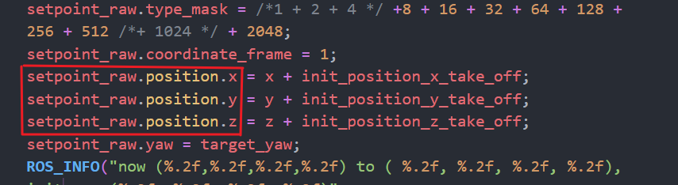
第一次看到 local_pos 后面的一串成员名，不必一下记住所有层级。先知道，它是一条 ROS 里程计消息，位置保存在这条消息的相应字段中；我们会从这些字段取出坐标。
**字段的意思，其实就是你学到的struct，很简单。**

给 setpoint_raw 填上目标，只是表达“希望去这里”。无人机运动需要时间，程序必须继续接收新位置，观察它是不是越来越接近目标。**发出目标、接收反馈、检查进度，这几件事会反复进行。**

这就是接下来阅读两个文件的主线。

## 三、cpp 和 h 分别负责哪一部分

打开 [template.cpp](src/template/src/template.cpp) 和 [template.h](src/template/include/template.h)。

- template.cpp 主要安排整个任务的执行过程：建立通信、读取配置、等待飞控准备、决定当前做哪个动作，以及什么时候换到下一个动作。
我们称之为**主控程序**。

- template.h 中放着这个主流程要用到的状态数据和辅助函数。例如，收到消息后怎样保存位置、怎样设置一个位置目标、怎样保持悬停，都在这里实现。
我们称之为**辅助程序**

- 在后来，你们将会遇到**联调** 。别人写的辅助函数如何融入到主控程序里面，如何在分别开发后，调试整个动作流程，这是第五关的内容。

我们来基础的看一下这个流程


```text
main 开头准备通信和参数
          ↓
等待飞控连接、处理起飞准备
          ↓
按 mission_num 选择任务
          ↓
调用 h 中的函数，填写目标并检查进度
          ↓
发布目标、处理新消息，再进行下一轮
```

下面先解释准备工作，再回到任务本身。

## 四、为什么 main 一开始要写这么多初始化
小朋友们，我们一开始看到这么一大团不知所云的东西，一定是不知所云的，但是事实上，这些对于我们来说，这甚至是不需要理解的。
本节只是为了看看，这些大概是干啥，就够了。

### 1. 先让程序能够使用 ROS 通信

```cpp
ros::init(argc, argv, "template");
ros::NodeHandle nh;
```
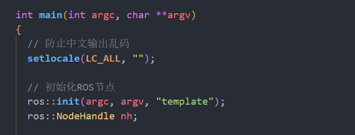
ros::init() 完成本进程使用 ROS 所需的初始化，并给节点设置名字。紧接着的 nh，是后面创建订阅、发布、服务客户端和读取参数时使用的入口。

这里第一次遇到 ros:: 这样的写法，跟std::差不多，就是命名空间的意思


### 2. 告诉 ROS：我要接收什么消息

例如下面这行：

```cpp
ros::Subscriber local_pos_sub =
    nh.subscribe<nav_msgs::Odometry>(
        "/mavros/local_position/odom", 10, local_pos_cb);
```
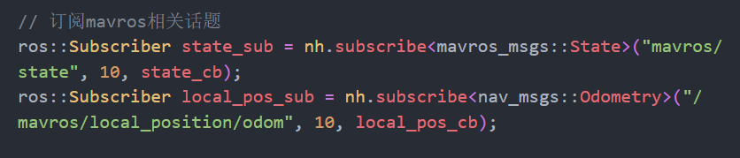
可以按三个问题读：

1. **接收哪里的消息？** /mavros/local_position/odom。
2. **接收什么样的数据？** nav_msgs::Odometry，里面有位置、姿态等字段。
3. **消息交给谁处理？** local_pos_cb。

这里的 10 是消息队列容量，可以先理解为等待处理的消息最多缓存多少条。它不是“每秒接收十次”。

另一个订阅器使用 state_cb 处理飞控状态，后面程序就能知道是否连接、是否解锁、当前是什么模式。

这里出现的“把消息交给函数处理”，就是**回调**。我们马上单独讲它。

### 3. 准备一个发送目标的出口

```cpp
ros::Publisher mavros_setpoint_pos_pub =
    nh.advertise<mavros_msgs::PositionTarget>(
        "/mavros/setpoint_raw/local", 100);
```
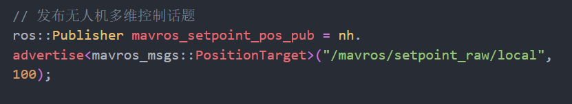
这一步创建发布器，约定将向 /mavros/setpoint_raw/local 发送 PositionTarget 类型的消息。

注意区分两件事：创建发布器时，只是把出口准备好；执行下面这行时，才真正发送当时的目标内容：

```cpp
mavros_setpoint_pos_pub.publish(setpoint_raw);
```

这也解释了为什么后面会同时出现“设置目标的函数”和 publish()。

#### 注意，这里就是真正的控制发送指令，但凡你要发送点，就需要通过这个话题publish

### 4. 准备模式与解锁请求

```cpp
ros::ServiceClient arming_client =
    nh.serviceClient<mavros_msgs::CommandBool>("mavros/cmd/arming");

ros::ServiceClient set_mode_client =
    nh.serviceClient<mavros_msgs::SetMode>("mavros/set_mode");
```
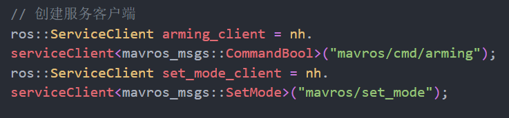
位置反馈需要持续接收，目标也需要持续发布；切换模式和解锁则是向飞控发起一项具体请求。在 ROS 中，这里使用服务客户端完成。

创建客户端时，也只是准备好请求入口。后面执行 set_mode_client.call(...) 或 arming_client.call(...) 时，才实际尝试发出请求，并检查响应。

#### 说白了，无人机起飞是需要申请的，这个就是请求发送的地方，就这么简单

本程序用到的 OFFBOARD，是让飞控接收外部程序控制目标的一种模式；“解锁”则对应允许进入可工作的状态。先理解这两个准备步骤与后续动作的关系，具体请求字段可以等读到对应调用时再看。

### 5. 准备循环频率、参数和开始条件

```cpp
ros::Rate rate(20);
```
**欸，这时候有同学就会问了**，为什么要持续更新呢？通过 MAVROS 进行 Offboard 控制时，我们持续向飞控发送控制目标，这份目标流也让飞控确认外部控制程序仍在工作。本例选用 20 Hz，让目标和反馈能不断更新；20 Hz 是这里选择的循环节奏，并不是协议规定只能使用这个频率。


后面主循环会反复更新目标、处理消息。rate 配合循环末尾的 rate.sleep()，让这个过程以大约每秒 20 次的节奏运行。

之后还有读取配置、打印参数、等待输入 1，以及等待飞控连接。它们分别解决“按什么配置执行”“配置是否读对”“是否开始”和“是否已经连接”的问题。
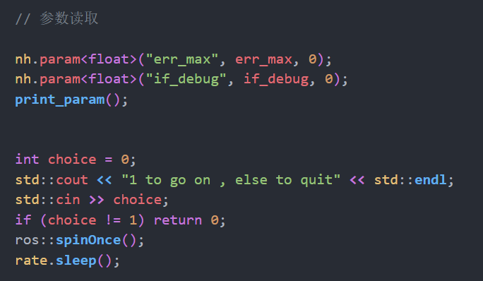

所以，main 开头可以分成三组来理解：

- **通信准备**：建立状态输入、目标输出和服务请求入口。
- **执行准备**：读取参数、设置循环节奏。
- **开始条件**：等待确认与连接，再进入任务流程。

初次编写自己的动作时，重点放在后面的任务部分；读懂这些准备工作怎样支撑任务即可。

## 五、回调：沿着一条位置消息的到来过程看（理解不了也没有关系）
一般来说，我们用函数是直接调用函数取值，需要等这次调用返回，才能拿到结果。

但是在这里我们获取位置消息的时候，我们不希望一直等待，我们希望**主控在等待新消息期间仍能继续执行**，于是先登记一个处理函数，等消息需要处理时再调用它，这就是这里使用的回调方式。

**程序刚启动时，** local_pos 还没有保存外部反馈的位置。

**main 执行到订阅语句时，** 把 local_pos_cb 的函数名传给 ROS，约定用它处理位置消息：

```cpp
ros::Subscriber local_pos_sub =
    nh.subscribe<nav_msgs::Odometry>(
        "/mavros/local_position/odom", 10, local_pos_cb);
```

这一步完成登记，返回订阅对象，主控便继续创建发布器、读取参数等后续工作。此时还没有通过这条语句取得位置，也不需要停在这里等待新消息。

**简单来说，就是把这个函数挂了个名，让ros可以写入了**

**稍后，一条位置消息到达。** ROS 将相应处理工作排入队列。主控执行到 ros::spinOnce() 时，ROS 处理待执行的回调，调用 local_pos_cb，并把这条消息通过 msg 参数交进去。

**进入回调后，** 先把消息内容复制到 local_pos，完成其余状态更新，

```cpp


void local_pos_cb(const nav_msgs::Odometry::ConstPtr &msg)
{
    local_pos = *msg;
    // 保留原函数中更新姿态角、初始位置等代码。
}
```

**回调执行结束，返回 ROS；spinOnce() 处理完后，返回主控。** local_pos 和标志都定义在回调外，因此保存下来的数据仍然存在，后面的代码可以继续使用。

**接下来，主控准备执行依赖位置的任务时，** 

```cpp
while (ros::ok())
{
    
        // 使用 local_pos，执行依赖位置的任务。
    
    ros::spinOnce();
    rate.sleep();
}
```

之后每次处理新位置消息，回调都会更新保存的数据，主控后续使用的便是最近一次已经处理过的位置。


## 六、为什么要有 YAML，程序又怎样读到它

打开 [template.yaml](src/template/config/template.yaml)，目前只有两项：

```yaml
err_max: 0.15
if_debug: 1
```

err_max 是位置到达判断允许的误差，单位为米；if_debug 用来选择是否自动请求 OFFBOARD。具体如何使用它们，仍由 C++ 代码决定。

### 1. 为了不编译！！！！

yaml修改，运行后直接读取，不需要catkin_make
这很重要，
- 因为一方面比赛场上时间争分夺秒，编译时间太久了；
- 另一方面，参数单独列出，十分清晰啊

### 2. 从文件到变量，中间经过什么

启动时执行的这条命令：

```bash
rosparam load src/template/config/template.yaml
```

会把 YAML 内容加载到 **ROS 参数服务器**。在这里，可以先把参数服务器理解为 ROS 环境中保存配置名称和值的地方。

main 再通过下面两行，把配置取到程序变量里：

```cpp
nh.param<float>("err_max", err_max, 0);
nh.param<float>("if_debug", if_debug, 0);
```

以第一行为例：

- "err_max"：要从 ROS 中读取的参数名称。
- err_max：把读到的结果保存到这个程序变量。
- 0：没有读到这个参数时使用的默认值。
- float：按浮点数类型读取。

完整过程是：

```text
硬盘上的 template.yaml
          ↓ rosparam load，或 launch 中的 rosparam 配置
ROS 参数服务器中的参数
          ↓ nh.param(...)
程序里的 err_max、if_debug
          ↓
后面的任务判断使用这些变量
```

随后调用的 print_param() 把这些值打印出来，正好可以帮助我们检查读取结果。虽然 err_max 在文件顶部定义时有初始值，后面的 nh.param() 仍会重新给它赋值；这里未读到参数时使用的是调用中写的默认值 0。


### 3. launch 帮我们省了哪一步

打开 [template.launch](src/template/launch/template.launch)，其中这行：

```xml
<rosparam command="load" file="$(find template)/config/template.yaml" />
```

负责加载 YAML，后面的 node 标签负责启动程序。这样，一份 launch 就可以安排加载配置和启动节点这两件事。

本篇为方便在终端输入 1，先采用手动加载配置、rosrun 前台运行的方式。理解了这条读取链路，再看 launch，就能知道它在替我们做什么。

## 七、从等待连接到起飞（这部分不用太看，理解不了也没有关系）

前面建立了通信、读取了参数，输入 1 后，程序接着执行这一段。它把准备好的通信入口实际用起来，直到满足当前代码的起飞准备条件，才进入后面的任务循环。

### 1. 先等飞控连接，同时继续接收反馈

```cpp
while (ros::ok() && !current_state.connected)
{
    ros::spinOnce();
    rate.sleep();
}
```

程序先检查 current_state.connected。如果还没有连接，就处理回调、稍作等待，再检查一次。某次 state_cb 收到“已连接”的状态并写入 current_state，下一轮就能退出这个等待循环。


### 2. 连接后，填写将要发送的两份请求

```cpp
mavros_msgs::SetMode offb_set_mode;
offb_set_mode.request.custom_mode = "OFFBOARD";

mavros_msgs::CommandBool arm_cmd;
arm_cmd.request.value = true;
```


offb_set_mode.request.custom_mode 填入 OFFBOARD，表示请求飞控切换到接受外部控制目标的模式；arm_cmd.request.value 填入 true，表示请求解锁。

注意执行到这里，只是把请求内容填好了。和给 setpoint_raw 赋值一样，填写数据与真正发送是两个时刻，发送发生在后面的 call()。

### 3. 记下时间，开始反复尝试模式与解锁请求（不用太看）

```cpp
ros::Time last_request = ros::Time::now();
```

last_request 先保存当前时间。接下来进入第一个主要 while 循环，每轮检查当前状态，再决定是否需要请求切换模式或解锁。
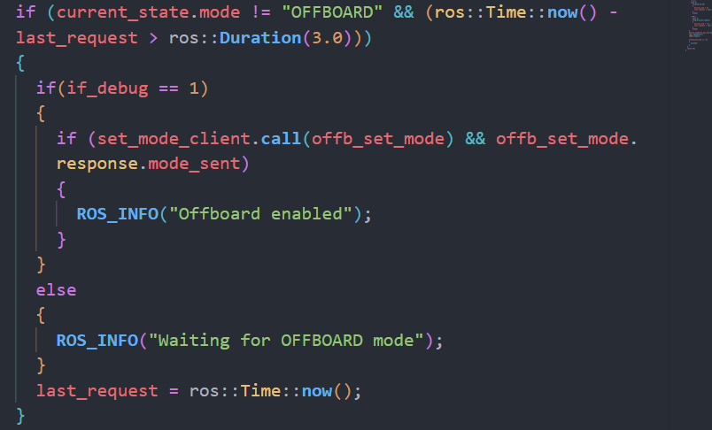
当
- 当前模式还不是 OFFBOARD，
- 并且距离 last_request 记录的时刻超过 3 秒时，
  进一步的分支
- if_debug 为 1 时，执行自动offboard
- if_debug为0时，打印消息

**这就是万一链接不上的自动offboard**
call() 使用前面准备的客户端发出请求，并取得服务响应。request 保存要发出的内容，response 保存这次调用得到的回复。


没有进入上述模式分支时，程序再检查解锁条件：当前尚未解锁，并且距 last_request 超过 3 秒，就执行：
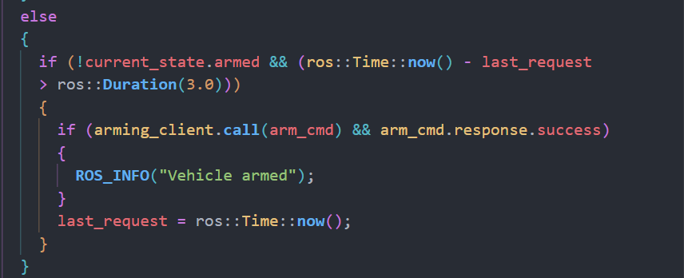
```cpp
if (arming_client.call(arm_cmd) && arm_cmd.response.success)
{
    ROS_INFO("Vehicle armed");
}
```

它把之前填写的 true 发出去，并检查本次解锁请求的响应。随后同样更新 last_request。

**这 3 秒是两次请求尝试之间的时间检查。** 程序没有在这里直接 sleep(3)，等待期间仍会继续执行循环后面的目标发布和消息处理。服务 call() 本身则需要等待服务响应。

### 4. 循环尚未退出时，持续给出起飞目标

每一轮在处理完前面的条件后，还会执行：

```cpp
mission_pos_cruise(0, 0, ALTITUDE, 0, err_max);
mavros_setpoint_pos_pub.publish(setpoint_raw);
ros::spinOnce();
rate.sleep();
```

missioncruise就是飞到那个点，publish就是发布这个命令


### 5. 满足高度与计时判断后，进入任务循环
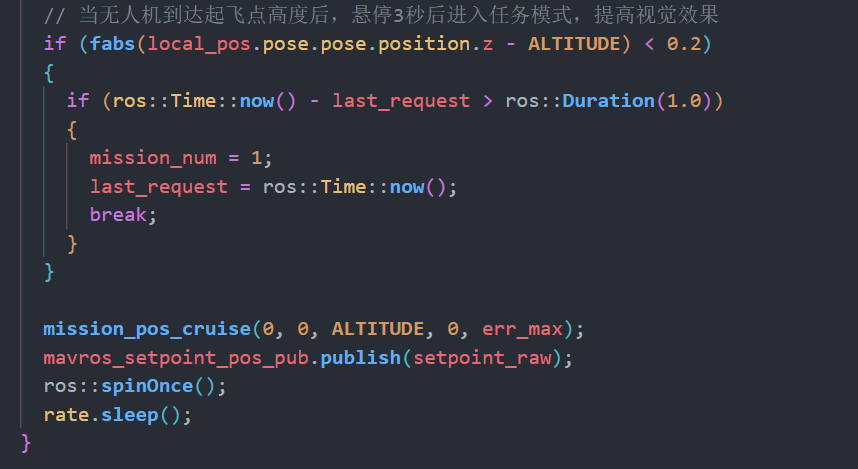
每轮执行到发布目标之前，代码会检查：当前反馈的 z 与 ALTITUDE 相差是否小于 0.2，以及距 last_request 是否已超过 1 秒。两项满足时，就把 mission_num 设为 1，更新时间，然后 break。

这个 break 退出的是当前起飞准备 while 循环，程序随后进入下面带 switch (mission_num) 的任务循环，从任务 1 开始执行。


现在可以把这一段连起来：**等待连接 → 填写模式与解锁请求 → 在循环中按状态和时间尝试请求，同时持续发布起飞目标、接收反馈 → 条件满足后，把控制权交给任务状态机。**

## 八、跟着一个位置任务读懂 cpp 和 h 的配合（最重要的）
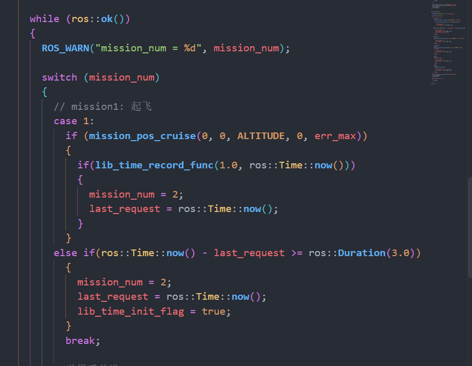
这里的switch包含的语句，就是状态机了，case 几，就是第几个阶段


你已经认识 if 和 switch 的语法。这里重点看新的执行方式：**每一次while都会处理回调，用新的信息执行case中的程序**

### 1. mission_pos_cruise()的控制

找到 h 中的 mission_pos_cruise()，它接收：

```cpp
bool mission_pos_cruise(float x, float y, float z,
                        float target_yaw, float error_max)
```

目标点xyz和机头的角度yaw

tALTITUDE 是当前定义的高度值；err_max 是到位置点的容差

### 2. 它怎样填写目标

函数中的关键赋值是：

```cpp
setpoint_raw.position.x = x + init_position_x_take_off;
setpoint_raw.position.y = y + init_position_y_take_off;
setpoint_raw.position.z = z + init_position_z_take_off;
setpoint_raw.yaw = target_yaw;
```

为什么要有init，这是防止无人机起飞的时候原点不是0，0，这样可以去除世界的偏移

### 3. 返回值为什么能表示进度
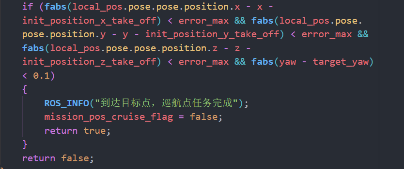
当前实现要求 XYZ 每个轴的位置误差都小于 error_max，同时 yaw 的误差绝对值小于 0.1 弧度。

满足条件，返回 true；暂未满足，返回 false。


### 4. 设置好的目标在哪里发出去

在 cpp 的任务循环末尾：

```cpp
mavros_setpoint_pos_pub.publish(setpoint_raw);
ros::spinOnce();
rate.sleep();
```

这一轮设置好的目标在这里发送，接着处理反馈消息，再按循环节奏等待下一轮。

于是，任务 2 实际上经历了：

```text
调用位置任务函数，填写目标
          ↓
检查当前反馈：尚未到达，返回 false
          ↓
仍保持任务 2，发布目标、处理新消息
          ↓
下一轮再次调用，使用更新后的位置判断
          ↓
满足到达条件，返回 true
          ↓
把 mission_num 改为 3，下一轮执行任务 3
```

这个配合方式是本关最需要理解的内容。后面自己写任务，也要让函数能够反复更新目标、报告进度，让主循环持续发布和处理反馈。
### 5. 重中之重：掩码决定哪些字段被使用

```cpp
setpoint_raw.type_mask =
    /*1 + 2 + 4*/ 8 + 16 + 32 + 64 + 128 + 256 + 512
    /*+ 1024*/ + 2048;
```

PositionTarget 消息可以装下位置、速度、加速度或力、yaw 和 yaw_rate 等字段。type_mask 是一组位标志，用来说明这些字段怎样被使用。

对下面表中的“忽略位”，**把对应数值加进掩码，就忽略那个字段；不加进去，就使用那个字段。** 所以，原写法中将某项注释掉，相当于不设置它的忽略位。

注释谁，就用了谁

| 数值 | 对应含义 |
| --- | --- |
| 1、2、4 |  position.x、position.y、position.z |
| 8、16、32 |  velocity.x、velocity.y、velocity.z |
| 64、128、256 |  acceleration_or_force.x、y、z |
| 1024 |  yaw，也就是目标偏航角 |
| 2048 |  yaw_rate，也就是目标偏航角速度 |

**512 是一个例外：它是 FORCE 标志，表示把 acceleration_or_force 字段解释为力。它不是姿态角的忽略位。** 上面原代码已经忽略了三个加速度 / 力字段，所以这里的 512 不参与这些字段的实际控制。本题后续写纯速度掩码时，可以省去它。


按上面的原掩码逐项看：位置和 yaw 没有被忽略，速度、加速度 / 力和 yaw_rate 被忽略。因此，这段代码使用的是**位置目标和目标朝向**。

也可以用消息类型中已有的常量名表达这些位，例如 `mavros_msgs::PositionTarget::IGNORE_VX` 对应 8，便于查阅。[PositionTarget 官方字段与标志定义](https://github.com/mavlink/mavros/blob/master/mavros_msgs/msg/PositionTarget.msg)


## 九、其余代码

理解上面的链路后，再看其他函数会容易一些。

**state_cb() 和 local_pos_cb()** 是状态输入。前者保存飞控状态，后者保存位置、提取姿态角并记录初始位置。初始位置目前只在尚未初始化且收到的 z 不为 0 时记录一次。先找到数据来源和保存位置，姿态转换细节可以后续展开。

**current_position_cruise()** 也设置位置目标，但它以首次调用时的位置作为 XY 偏移起点，z 直接使用传入值。它没有按机头方向旋转 XY；第一次阅读时，把它与 mission_pos_cruise() 的赋值对照一下即可。以后连续安排多个相对位移动作时，还要留意它的初始化标记没有在成功返回时自动复位。

**hover()** 在第一次进入时记下当前位置、朝向和时间，随后每轮继续发送相同的保持目标，经过指定时间后返回 true。它展示了“反复调用同一个函数，在多轮之间记住状态”的方式。

**lib_time_record_func()** 提供计时：第一次调用记录开始时间，后续调用比较已经经过多久，达到指定时长后返回 true 并复位。它让主流程在等待时仍然能够继续循环。

**precision_land()** 填写现有的降落目标，并在经过 5 秒后返回 true。这里的 true 表示当前代码规定的计时条件满足，并没有检查是否已经触地或解除锁定。不同任务函数用什么条件表示完成，要分别看实现。

**print_param()** 在 cpp 中负责打印已读取的参数，**main()** 则把前面讲到的准备、起飞和任务执行组织起来。

前面的第七节已经沿着起飞准备过程说明了模式请求、解锁、目标发布和循环退出；后面的 case 则用于编排具体动作。

当前任务 1 还带有超时推进分支；位置函数之外，有些任务依靠计时完成。阅读任务顺序时，要同时看调用的函数和外层的切换条件，不能把所有任务都理解成“到达目标才切换”。


